# hn

**Hacker News for people who read the comments.** A native Mac app and a terminal app, both driven from the keyboard. Both can summarize a story and its discussion, and every point in a summary links to the comment it came from.

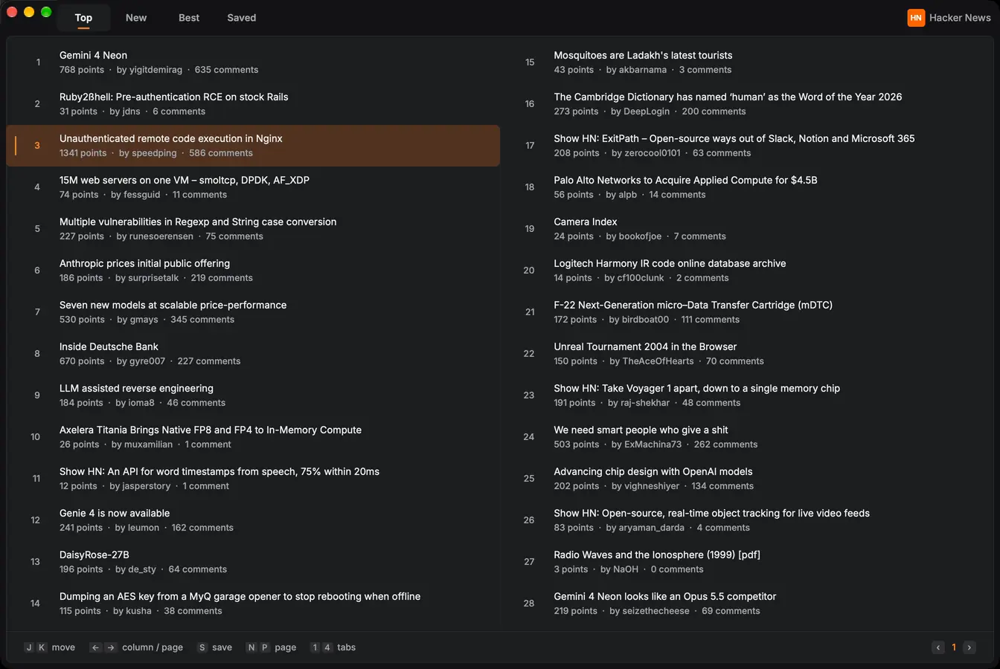

| | Mac app | Terminal app |
|---|---|---|
| **Get it** | [Download HN for macOS](https://github.com/Shaance/hn/releases/download/desktop-v1.1.0/HN-desktop-v1.1.0-macos-arm64.zip): Apple Silicon, macOS 13+, signed and notarized | `cargo install --path . --locked`, then `hn` |
| **The article** | The story's live page, beside the discussion | Opens in a Ghostty pane beside the discussion, or your browser |
| **More** | [desktop/README.md](desktop/README.md) | [Terminal app](#terminal-app), below |

## The Mac app

| Dark | Light |
|---|---|
| 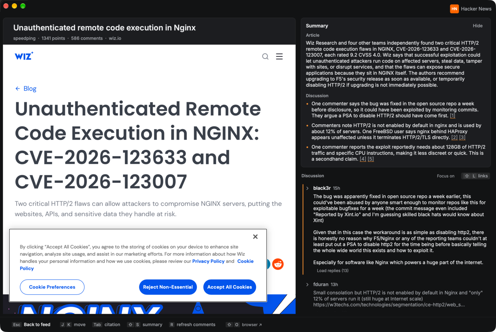 |  |

- **The real page, next to the thread.** Opening a story puts its page on the left and the discussion on the right. Drag the divider, or hide the discussion with `⌘\`.
- **Summaries you can check.** The article and discussion summaries stay pinned above the comments. `Tab` selects a citation and `Enter` opens the comment behind it, with its replies.
- **The terminal app's keys.** `j`/`k` to move, `Enter` to open, `Esc` to go back, `s` to save, and `1`–`4` for Top, New, Best and Saved. `?` lists every key.
- **Uses the room it has.** On a wide window the feed shows two columns. `⌘=`, `⌘-` and `⌘0` zoom the whole window, the page included.
- **Shares your setup.** Saved stories and summary settings, API key included, live in the same files the terminal app uses.

| Read the cited comment | Two-column feed |
|---|---|
| 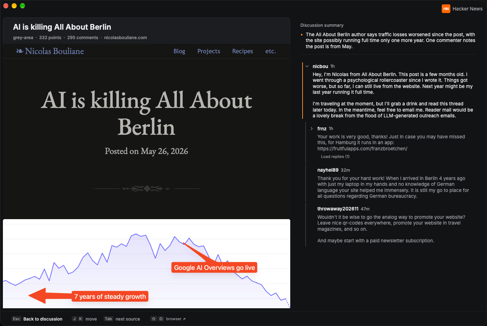 | 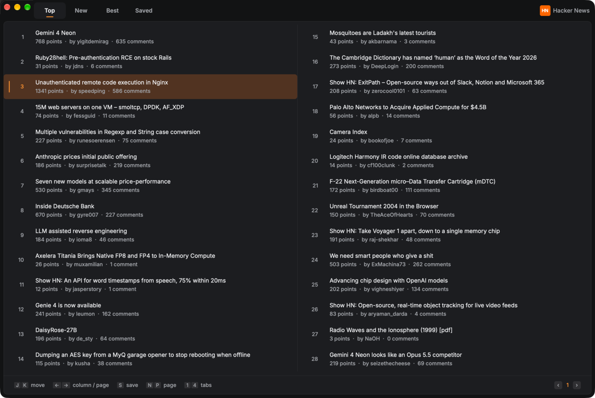 |

**Install:** download the zip above, unzip it, and drag **HN** to Applications. Summaries are optional: open Settings with `⌘,` and add an OpenRouter or Anthropic key. To build it yourself, run `cd desktop && cargo run --release`; rustup fetches the pinned toolchain. The [desktop README](desktop/README.md) covers the details.

## Terminal app

Read stories and comment threads in your terminal. Save stories for later, keep your place in a discussion, and optionally generate article and discussion summaries through OpenRouter or Anthropic.

On macOS with Ghostty, you can open the original article in a companion browser pane beside the discussion. Other setups open it in your default browser.

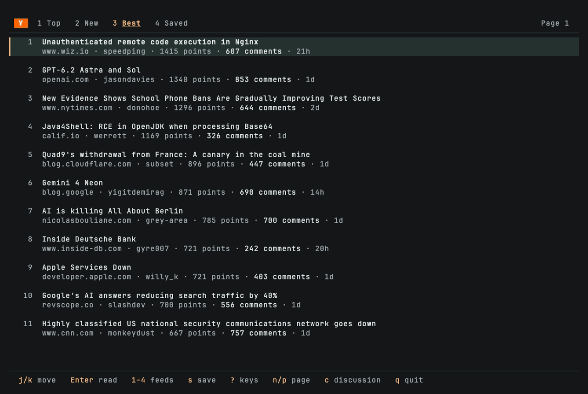

## Run it

Build from this checkout with Rust and Cargo:

```sh
cargo install --path . --locked
hn
```

Or run without installing:

```sh
cargo run --release
```

Browsing and saving stories work without an API key. Summaries and the Ghostty article pane each have optional setup below.

Cargo installs `hn` into `$CARGO_HOME/bin`, normally `~/.cargo/bin`. Keep that directory on your shell's PATH. Run the same install command after updating the checkout to update the binary. Installation leaves saved stories, summary settings, and API keys in place; you can run `hn` from any directory.

## Colours

hn detects colour support and queries the terminal theme once at startup (up to 250 ms).
Truecolour uses a detected light or dark palette; unknown backgrounds use ANSI colours. `NO_COLOR` disables colour.
Set `HN_THEME=light`, `HN_THEME=dark`, or `HN_THEME=ansi` to override detection, including `NO_COLOR` (case-insensitive).

Set `HN_REDUCED_MOTION=1` to disable visual animations; ANSI and monochrome palettes disable them automatically.

## Read a story

Use `j/k` or the arrow keys to select a story. Press `1`, `2`, or `3` for Top, New, or Best; `4` opens Saved. Use `n/p` to change pages — or press `j` past the last story to continue on the next page's first story, and `k` at the top to go back to the last story of the previous page (further `j/k` wait while the page loads).

Press `o` or Enter to open the discussion and its article. Press `c` to read the discussion without opening a new article pane. If a companion pane is already open, it follows the selected story. `O` always opens the story in your default browser.

In a discussion, `j/k` moves between comments. Enter expands or collapses replies, `[/]` skips between sibling threads, and `u` returns to the parent. Folding keeps replies in memory, so reopening restores nested expansions immediately. Press `r` to refresh the comments, including every reply you have loaded. Page Up/Down scrolls through long comments without changing the selection. Original post text appears above the replies, with paragraphs and indented code preserved. Press `L` to choose a link from the post or selected comment.

Return to the feed with Esc; if a companion article pane is open, hn closes it (only the tab hn created — your own tabs in that pane stay open; if it was the last tab, the whole pane closes). Reopening the discussion during the same run restores loaded replies, selection, and scroll position. Press `?` for help.

### Save for later

Press `s` in the feed or discussion to save or unsave the story. Saved stories survive restarts and need no account. They store the story details as they were when saved; article content, loaded replies, and reading position are kept separately for the current run.

If the saved file cannot be read, hn preserves it and displays a notice. After correcting the file or its permissions, open Saved with `4` and press `r` to reload it.

## Optional AI summaries

Open a story, press `M`, choose **OpenRouter** or **Anthropic** under Provider, enter that provider's API key, and press Enter. For Anthropic, use a personal key scoped to a workspace in the [Claude Console](https://platform.claude.com/settings/keys).

Keys entered in this form and your preferences are saved in `~/.config/hn/summary.json` (or `$XDG_CONFIG_HOME/hn/summary.json`) with owner-only permissions. They remain available after restarting or reinstalling `hn`.

You can also supply `OPENROUTER_API_KEY` or `ANTHROPIC_API_KEY`. On a fresh setup, an Anthropic key alone selects Anthropic; otherwise OpenRouter is the default. Saved provider choices take precedence. Each provider keeps its own key, and a key saved in settings takes precedence over that provider's environment variable. Environment keys are not copied into settings unless you edit them through the form.

The installed binary does not read `.env.local`. That file is only used by the [development runner](#development). If you previously used it, enter your key once in `M` when running plain `hn`, or export the provider key in the shell that launches `hn`.

Summaries send extracted article text and sampled comment excerpts directly to the selected provider using your API credits. No separate summary service is required. Changing provider preserves completed summaries and applies to new requests; there is no automatic fallback to the other provider.

Automatic summaries are on by default once a key is available. They start when you open a story, while you continue reading. In `M`, use Tab or the arrow keys to select a setting, Space or left/right to change it, Enter to apply, and Esc to cancel. Turn Automatic summaries off to generate them only when requested with `S`. Requests already submitted can still finish.

### Fast and Thorough

| Profile | Configured model | Discussion summary |
|---|---|---|
| Fast (default) | Claude Haiku 5.5, low reasoning | Up to three main insights, including disagreements when they affect the takeaway. |
| Thorough | Claude Sonnet 5.5, low reasoning | Broader coverage, with extra points when they preserve a useful reason or qualification. |

Both profiles also generate a compact article summary. Thorough works independently from the captured sources; it does not take the Fast summary as a draft. OpenRouter uses `anthropic/claude-haiku-5.5` and `anthropic/claude-sonnet-5.5`; Anthropic uses `claude-haiku-5-5` and `claude-sonnet-5-5`. The prompts are identical across providers. Fast asks for at most three insights. OpenRouter also receives that limit in the JSON schema; Anthropic does not support that schema constraint, so its limit relies on the prompt.

### Read and check a summary

The summary stays pinned above the comments. `S` hides or shows it without moving your comment position. When it is too long to fit, `J/K` scrolls the summary while `j/k` continues to navigate comments.

Discussion points include numbered citations. Press Tab or Shift-Tab to select one, then Enter to read the cited comment and parent context. The source viewer identifies the excerpt sent to the model and labels additional captured text below it. Browse replies below the captured text with `j` and `k`. Enter or `o` expands, folds, continues a deep thread, or retries an unavailable comment. Use `c` to fold, Backspace to move up the source trail, `f` to toggle focus, and Page Up or Page Down to scroll. Tab and Shift-Tab switch citations. Press `h` or Esc to return to the focused citation and resume at the same discussion position.

Summaries show their capture time and source coverage. Article extraction can be partial, and discussion summaries use a sample of comments that includes replies. A citation links to captured evidence; it does not guarantee that the model interpreted it correctly.

### Revisit, change model, or refresh

Returning to a story reuses its results without another model request, even if you changed the default profile elsewhere. Successful article and discussion summaries are saved separately and shared with Hacker News Desktop. A restored summary shows its age and keeps its citations. The discussion header also shows how many comments have been added since it was saved.

Applying a model choice in `M` sets the default for future summaries. If it replaces a restored summary, hn captures fresh sources. Results generated during this run can reuse the retained input. Only the latest result is retained, so explicitly switching back to a previous model can require another paid request. Saving unrelated settings does not replace an existing summary.

Choose **Refresh sources & summary** in `M` to fetch newer article and discussion content and generate new results. Press `r` to refresh visible comments without making summary requests. After a summary failure, press `M`, then Enter on **Retry failed summary** to retry only failed sections. Retries reuse available in-session input and capture fresh sources when replacing a restored summary. Existing summaries stay readable during replacement or failure, and a citation you are viewing keeps its captured text until you leave it.

On startup, hn deletes saved summary halves older than 30 days. Reading positions and in-progress requests start fresh after a restart.

## Optional Ghostty article pane

The companion pane supports macOS with Ghostty and terminal-browser v0.13.4. The hn terminal must be at least 110 columns wide when opening a new pane. Follow the [Ghostty setup instructions](scripts/ghostty/README.md) to install the browser and its pane-specific Cmd+W binding. The installer copies the browser into your user data directory and adds a launcher under `~/.local/bin`; running `hn` then needs no development launcher or checkout-local browser.

Press `o` to open the article beside the discussion. For the same story, `o` focuses the existing browser tab and preserves its scroll position and any page you followed within that tab. Opening a different story replaces hn's article tab in the existing companion. Unrelated browser tabs and terminal panes are left alone.

With the documented setup, Cmd+W in the companion closes that pane without the terminal confirmation or a “Process exited” screen. Press `o` to reopen it. The setup requires a one-time Ghostty configuration edit; running hn does not change global configuration or other panes' close behavior.

Other terminals, narrower initial windows, or a missing terminal-browser executable use the default browser. If you expected a split pane, run `command -v terminal-browser` and `terminal-browser --version` in the same Ghostty shell as `hn`. The version should be v0.13.4. If the companion fails to launch, `O` opens the story externally.

## Keyboard reference

Keys are case-sensitive: `s` saves a story, `S` controls its summary; `o` opens the companion when available, `O` always opens externally.

### Feed

| Key | Action |
|---|---|
| `j` / `↓` | Next story; at the last story, continues on the next page's first story |
| `k` / `↑` | Previous story; at the first story, goes back to the previous page |
| `g` / `G` | First / last story on the page |
| `n` / `Space` / `PgDn` | Next page |
| `p` / `PgUp` | Previous page |
| `←` / `→` | Column / page on wide terminals, column in wide Saved, previous / next page on narrow terminals |
| `1` / `2` / `3` | Top / New / Best stories |
| `4` | Saved stories |
| `s` | Save or unsave selected story |
| `Enter` / `o` | Open discussion and article |
| `O` | Open story in default browser |
| `c` | Open discussion |
| `r` | Refresh current page; reload saved file in Saved |
| `?` | Toggle help |
| `q` | Quit |

At 160 columns and above, stories fill the left column first, then the right. Both columns scroll together. At the outside edge of a paged feed, `→` opens the first story of the next page and `←` opens the last story of the previous page.

### Discussion and summary

| Key | Action |
|---|---|
| `j` / `↓`, `k` / `↑` | Next / previous comment |
| `]` / `[` | Next / previous sibling thread |
| `u` | Parent comment |
| `Backspace` | Re-root a reply thread at its parent |
| `g` / `G` | Top / bottom |
| `Page Up` / `Page Down` | Previous / next screen of text |
| `Enter` / `l` / `→` | Expand or collapse replies |
| `c` | Collapse current thread |
| `o` | Open or focus article companion |
| `O` | Open story in default browser |
| `S` | Set up, generate, or show/hide summary |
| `M` | Summary provider, key, automatic mode, profile, and refresh |
| `Tab` / `Shift-Tab` | Select next / previous summary citation |
| `Enter` on a citation | Read captured comment and parent context |
| `J` / `K` | Scroll an overflowing summary |
| `L` | Choose a link from the post or selected comment |
| `s` | Save or unsave current story |
| `r` | Refresh comments without generating summaries |
| `Esc` / `q` / `h` / `←` | Back from a source to the discussion, or from the discussion to the feed |
| `?` | Toggle help |

Selecting a reply shows its ancestor trail above the discussion. Backspace moves to the parent and shows its thread. At the discussion depth limit, Enter or `o` continues the selected thread. Press `f` to toggle dimming of unrelated comments.
While viewing a cited source, `j/k`, Page Up/Down, and `g/G` scroll its text. In the link picker, use `j/k` to select, Enter to open, and Esc to close.

## Local files

| Data | Default location | Lifetime |
|---|---|---|
| Saved story details | `~/.local/share/hn/saved.json` | Until unsaved or deleted |
| Summary settings and any key entered in the form | `~/.config/hn/summary.json` | Across restarts |
| Summary response diagnostics (both providers) | `~/.local/state/hn/summary-responses/` | Until manually deleted |
| Optional article browser | `~/.local/share/hn/terminal-browser-v0.13.4/` | Across hn reinstalls |
| Saved summaries and citation sources | `~/.local/state/hn/summaries/<id>.{article,discussion}.json` | 30 days, pruned on startup |
| Captured inputs for regeneration, replies, and reading positions | Memory only | Current run |

`XDG_DATA_HOME`, `XDG_CONFIG_HOME`, and `XDG_STATE_HOME` override the corresponding directory roots. Settings, saved summaries, and diagnostic files use owner-only permissions on Unix. A key entered through the form is stored in the settings file; it is not an OS keychain entry.

Each JSON file records the timestamp, provider, model, story title, HTTP status, generation ID, request ID when supplied, and raw response body. It can contain summary or error text. Request headers and full prompts/article/comment inputs are not logged, and an echoed active key is redacted. Logging failures do not interrupt reading or trigger another request.

Diagnostics are for investigation and are not used as a summary cache. Deleting the diagnostic directory is safe. Earlier versions wrote them to `~/.local/state/hn/openrouter/`; that folder can be deleted.

## Development

From a checkout, run:

```sh
./scripts/dev.sh
```

The runner builds and starts hn. It optionally reads an ignored `.env.local` containing `OPENROUTER_API_KEY=value` and/or `ANTHROPIC_API_KEY=value`, with optional quotes. An existing environment key takes precedence over the env file. The file is read as data, never executed. Pass another env-file path as the first argument if needed. The browser uses the same installed `terminal-browser` command as plain `hn`.

### Verify without Ghostty or API keys

Run the recorded reader checks with Rust and [uv](https://docs.astral.sh/uv/) installed:

```sh
scripts/verify-reader.sh
```

This runs formatting and the Rust tests, then exercises the real terminal event loop with recorded discussions and summaries. It checks navigation, citations, refresh, failure and retry, and retained reading positions. Styled captures are saved at 240×80 and 200×60 terminal cells; use `--size 220x70` to match your window. See [recorded reader verification](tests/reader/README.md) for the scenarios and artifacts.

After installing `hn`, check the installed binary separately:

```sh
uv run --with pyte python scripts/verify-installed.py
```

This finds `hn` on PATH, launches it outside the checkout, changes settings through the keyboard, and restarts it to check they persist. It uses a temporary home, a fake key, and blocked network requests. Your settings are untouched. Pass `--binary /path/to/hn` to check a specific installation. Both commands save terminal captures and need no computer-use access; uv may download pyte on its first run.

The [browser installer check](scripts/ghostty/README.md#verify-without-opening-ghostty) verifies the copied distribution independently of its source. Rust socket tests check tab reuse and ownership. Native Ghostty focus, rendering, and Cmd+W closure still need the short check in that guide when the browser integration changes.

### Live provider check

With the selected provider's key available and `uv` installed, run the live terminal smoke test:

```sh
uv run --with pyte python scripts/smoke.py --provider openrouter
# Or test direct Anthropic access:
uv run --with pyte python scripts/smoke.py --provider anthropic
```

This command calls live Hacker News and the selected provider and makes six paid model requests. It uses temporary settings, saved items, and diagnostic logs, and prints the paths to those files and its terminal captures. It checks Fast/Thorough, summary toggling without moving comments, retained results, citations, refresh, reply navigation, and clean exit.

Summary accuracy needs the source-grounded review in [tests/quality/README.md](tests/quality/README.md); a successful smoke test does not establish factual accuracy.

### Code layout

The app uses ratatui and crossterm for terminal rendering and input, Tokio for asynchronous work, reqwest for HTTP, and Readability for article extraction.

| Area | Responsibility |
|---|---|
| `src/main.rs`, `src/reader_actions.rs` | Event loop and keyboard coordination |
| `src/app.rs`, `src/app/` | Feed, comment tree, and retained discussion position |
| `src/bookmarks.rs` | Saved-story persistence |
| `src/hn_client.rs`, `src/hn_cli_service.rs` | Hacker News requests and conversion to displayable content |
| `src/reader.rs`, `src/reader/` | Captured sources, summary jobs, settings, source viewer, and article companion |
| `src/reader/summary_prompts.rs` | Article, Fast discussion, and Thorough discussion instructions |
| `src/ui/` | Feed and comment rendering |
| `src/reader/tests/` | Reader navigation, summary lifecycle, and settings tests |

## Contributing

See the [contributor guide](CONTRIBUTING.md) for setup, checks, and pull requests.
Use the [security policy](SECURITY.md) to report a vulnerability privately.

## Screenshots

| Feed | Reader with summary |
|---|---|
| 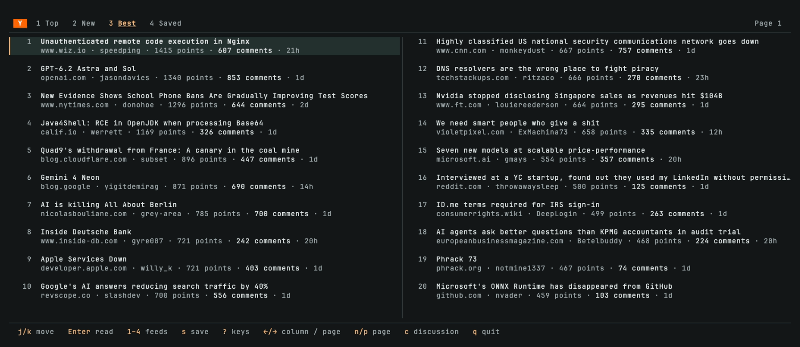 | 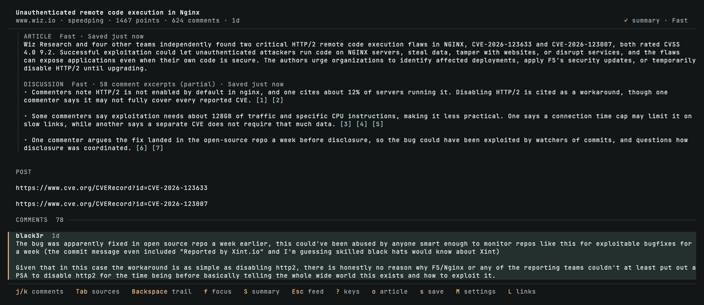 |
| **Citation focus** | **Key reference** |
| 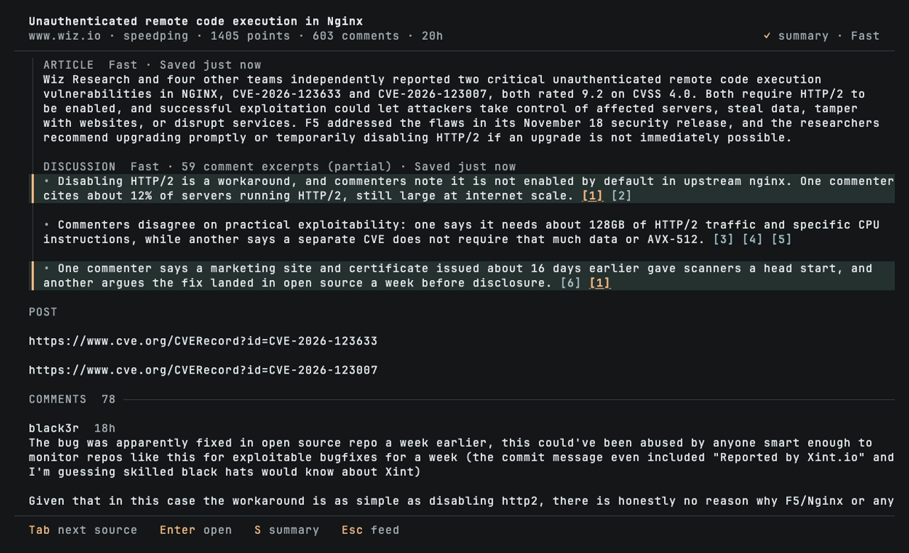 | 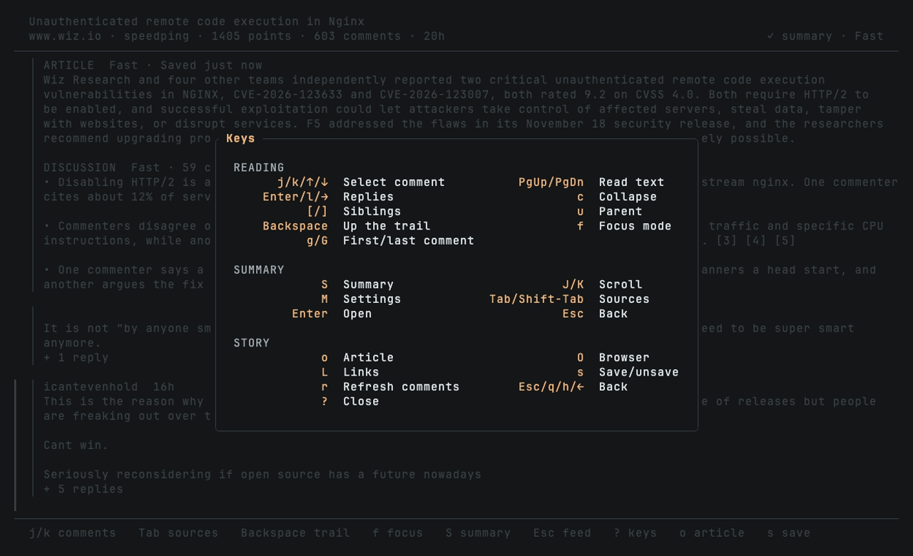 |

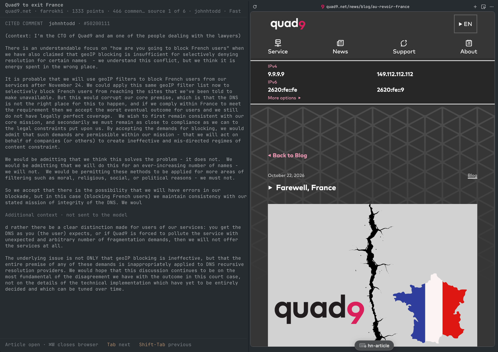

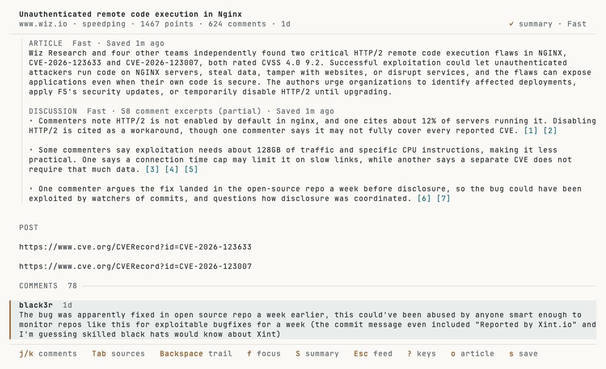

The stills of a single terminal are captured from the real app with [vhs](https://github.com/charmbracelet/vhs). To regenerate them after a UI change, run `scripts/readme-screenshots.sh`; it also renders the demo GIF from `scripts/readme/demo.tape`. It uses live Hacker News and an OpenRouter key from the environment or `.env.local` (one summary, which the later recordings reuse once saved; a few cents). The article pane still is recorded in a real Ghostty window, because vhs cannot open Ghostty splits.

## About

This project was created as a learning exercise to explore Rust and terminal UI development.

## Browser preview

[Try hn in your browser](https://hn.hashcode.dev). The native CLI runs against a daily snapshot in an offline container. [Preview development and tests](preview/README.md) · [Deployment operations](preview/deploy/README.md).
