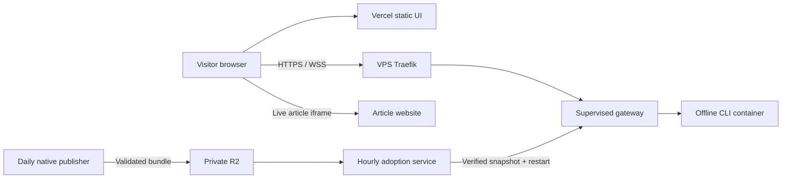

# Public preview implementation plan

Owner: this worktree. Public launch completed 2026-10-26; one development publisher feeds both gateways through the existing dev/ R2 channel. Status and evidence: `evidence/run-ledger.md`. This plan continues the tested VPS prototype; it does not replace its isolation model.

## Outcome

Serve the browser UI at `hn.hashcode.dev` on Vercel. Connect it directly to `hn-session.hashcode.dev` through the existing VPS Traefik proxy. The gateway runs as the dedicated `hnpreview` user with its own rootless daemon and pinned patched gVisor. A separate daily publisher captures one page per Top/New/Best feed, up to 20 comments per story, extracted articles and one useful non-X featured summary per feed. It uploads immutable bundles to a private R2 bucket, then updates `latest.json`. Failed captures retain the last good version.

The VPS runs the native publisher through a systemd timer. No Worker is needed for direct R2 upload. Visitor containers remain offline and never receive R2 or AI credentials. Keep existing application deployment/secret boundaries intact.

The publisher uses the native Fast profile with Anthropic directly, selected in its existing summary configuration. Its API key is supplied only to the separate publisher service. The initial Mac experiment used OpenRouter; scheduled VPS publishing uses Anthropic per the user's preference.

The live article loads in the visitor's browser. It does not give the CLI container network access. Sites can still refuse embedding; the original-site link remains available.

## Implementation order

1. **Session and UI contract.** Keep one snapshot pinned for each gateway process. Expose its bytes at `/snapshots/<sha256>.json`; the existing WebSocket `ready.hash` identifies the version. Load that exact snapshot on each new browser session before displaying terminal output or enabling input. Remove the unversioned `/snapshot` endpoint and update its consumers. Build a static-only Vercel output with an explicit backend origin and matching CSP. Preserve local same-origin development.
2. **Native publishing.** Extend the existing capture command to prepare featured summaries through the native provider boundary. Add a noninteractive snapshot-validation command using the existing schema validator. Keep capture and summary preparation transactional. Use one publishing script for R2 object upload/readback and latest-pointer update; reuse the native validator rather than reimplementing its schema in JavaScript.
3. **Supervision and adoption.** Add systemd definitions for the preview gateway and separate publisher identity/timer. A trusted adoption step downloads the latest bundle to a temporary file, verifies digest and native schema, then replaces the local input and restarts the gateway. The previous valid input stays available for recovery. Daily restart can end active previews; their restart action reloads the matching version. No hot-swap machinery in the first release.
4. **Routing and deployment.** Stage source-controlled Traefik routing in `summarizer-compose`. Use a private host bridge address reachable from Traefik, with no public gateway port and no shared production Docker socket. Deploy development first. Wire Vercel, DNS and certificates only after actual provider access and private integration checks succeed. Preserve existing names, routes and service identities.
5. **Acceptance.** Exercise new and restarted browser sessions across two different snapshots; real capture/summary and R2 upload/readback; failed capture/upload/validation retaining the previous version; systemd restart and orphan cleanup; rejected origin/Host; actual HTTPS/WSS through the proxy; desktop/mobile article, summary and comments; final existing-application health and listener readback.

## Configuration and artifact decisions before edits

- Extend `server.mjs`, `app.js`, `index.html`, `snapshot_capture.rs` and native reader code at their current ownership boundaries.
- Add `/healthz` with the active snapshot digest for readiness and adoption readback; it must not expose credentials or container details. Replace `/snapshot` with the digest-addressed route. The existing `ready.hash` remains the sole version selector; do not add another manifest protocol to visitor sessions.
- Add backend-origin metadata to the static UI, generated by `build-ui.mjs`. Packaging is separate from the gateway so Vercel receives only public assets, never the local snapshot, server code or credentials.
- Add `--validate-snapshot PATH` and `--prepare-snapshot PATH` as real operator commands. The former shares `Snapshot::load`; the latter enriches a captured file through native summary generation. Ordinary capture remains usable without paid inference.
- Add `publish.mjs` for the R2 transaction boundary and `adopt.mjs` for the local service update boundary. HTTP serving must not own cloud credentials or administrative service restarts. Use maintained signing/storage libraries, not custom cryptography.
- Add only deployment settings that the selected environment needs: public backend origin, private bind address, absolute snapshot path, immutable image reference, bucket/account credentials in protected service configuration. No credentials in static bundles, Git, image layers or logs.
- New manifests contain only version, generation timestamp, object key and SHA-256. Bundle bytes are immutable. Update the latest pointer only after object upload and readback succeed. Do not apply blanket seven-day expiry: it would delete the current version during an extended publishing outage. Retention remains a separate pending step that must preserve the current/last-good object.
- Proxy wiring uses Traefik's file provider in the canonical Compose repository: one shared dynamic route file, mounted read-only, with an explicit HTTPS router/certificate name and upstream `172.18.0.1:8782`. Both actual hosts currently use that address for `traefik-public`; recheck it at deployment. Docker labels cannot describe this host systemd service without inventing an extra container. This introduces no additional proxy process or Docker socket grant. Bind the gateway only to that private interface after private validation; firewall/public-listener verification remains a rollout gate.

## Budgets

| Category | Maximum changed lines | Artifacts |
|---|---:|---|
| Gateway/UI/version contract | 180 | Existing files plus static build script |
| Native publisher and validation | 160 | Existing capture/reader/main files |
| Cloud publish/adoption | 260 | Two scripts; one small signing dependency |
| Deployment configuration | 220 | systemd units/install instructions; canonical proxy change |
| Verification | 300 | Extend existing tests; one publisher boundary harness |
| Documentation | 180 | This plan and operator instructions |
| Review corrections | 100 | Demonstrated failures only |

Generated lockfiles, snapshots, archives, logs and screenshots are separate. Stop feature expansion and explain any budget revision. No independent agents or delegated model runs are planned.

## Launch gates and rollback

Publication rejects any supplied summary shorter than 40 words before the first R2 write. This completeness floor catches the actual 31-character failed summary, while leaving room around the prompt's 60–90-word target. A rejected draft cannot replace the published snapshot; there is no automatic model retry. This does not check factual accuracy or guarantee that longer summaries are useful. The native validator continues to own snapshot structure.

Credentials and provider project/domain ownership must be verified before external changes. Do not substitute an unrelated temporary deployment for the requested custom-domain setup. Do not promise zero provider charges; keep inference to at most three selected stories per daily run and fail visibly when credentials/budget are unavailable.

Do not publish publicly until real development checks pass. A rollout must preserve the existing TLDW Compose source of truth; no hand-edited server Compose drift. Keep the prior gateway image and validated snapshot for rollback, and remove only the preview route/service if rollback is required. The custom gVisor patch remains a maintenance obligation until a verified official release supports this setup.
